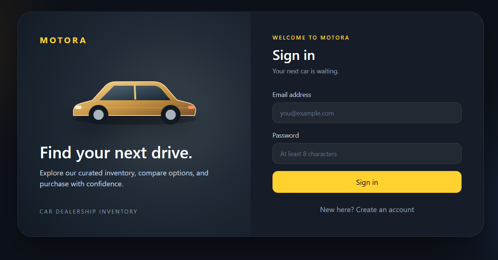
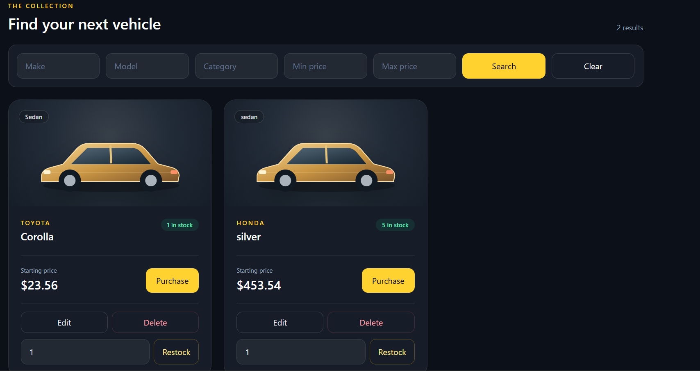

# Motora — Car Dealership Inventory System

A full-stack car dealership inventory application built with FastAPI, SQLite, React, Vite, and Tailwind CSS. Users can register, sign in, search vehicles, and purchase available stock. Admins can manage inventory through the dashboard.

## Screenshots

### Login



### Inventory



### Admin dashboard


## Features

- User registration and login with password hashing and JWT bearer tokens
- SQLite-backed vehicle inventory
- Search by make, model, category, and minimum or maximum price
- Vehicle purchasing that decreases stock and rejects sold-out purchases
- Admin-only deletion and restocking
- Responsive React dashboard with Tailwind CSS
- Admin interface for adding and editing vehicles
- Purchase buttons disabled when stock is zero

## Tech stack

| Layer | Technology |
| --- | --- |
| Backend | Python, FastAPI, SQLModel, SQLAlchemy |
| Database | SQLite file |
| Authentication | Argon2 password hashing, JWT |
| Frontend | React, HTML5, CSS3, Tailwind CSS, Vite |
| Testing | pytest, FastAPI TestClient, pytest-cov |

## Requirements

- Python 3.10 or newer
- Node.js 20.19+ or 22.12+
- npm
- Git

## Run locally

Clone the repository:

```powershell
git clone https://github.com/This-AnneGeorge/AnneGeorge_Incubyte.git
cd AnneGeorge_Incubyte
```

### 1. Start the backend

Open a terminal in the repository root:

```powershell
cd backend
python -m venv .venv
.\.venv\Scripts\python.exe -m pip install -r requirements.txt
```

Set a JWT signing secret for this terminal session:

```powershell
$env:JWT_SECRET_KEY = (& .\.venv\Scripts\python.exe -c "import secrets; print(secrets.token_urlsafe(32))")
```

Start the API:

```powershell
.\.venv\Scripts\python.exe -m uvicorn app.main:app --reload
```

The API runs at `http://127.0.0.1:8000`. Interactive API documentation is at `http://127.0.0.1:8000/docs`. The SQLite database file, `backend/dealership.db`, is created automatically and is excluded from Git.

Keep the backend terminal open. If you restart it with a newly generated JWT secret, sign in again because tokens signed with the previous secret will no longer work. Set a stable secret through your environment when persistent sessions are needed.

### 2. Start the frontend

Open a **second terminal** in the repository root:

```powershell
cd frontend
npm ci
npm run dev
```

Open `http://localhost:5173/` in your browser. During local development, Vite forwards `/api` requests to the backend on port 8000. Keep both servers running.

### 3. Create an admin account

Register normally in the frontend first. Registration always creates a regular user.

Then, in a terminal inside `backend`, promote that existing account:

```powershell
.\.venv\Scripts\python.exe promote_admin.py "your-email@example.com"
```

Replace the example email with the email you registered. Sign out and sign in again to display the admin controls. Do not expose an admin promotion endpoint to public users.

## API endpoints

All vehicle endpoints require an `Authorization: Bearer <token>` header.

| Method | Endpoint | Purpose | Access |
| --- | --- | --- | --- |
| POST | `/api/auth/register` | Register with email and password | Public |
| POST | `/api/auth/login` | Receive an access token | Public |
| GET | `/api/auth/me` | Get current user and role | Signed-in user |
| POST | `/api/vehicles` | Add a vehicle | Signed-in user |
| GET | `/api/vehicles` | List vehicles, including sold-out entries | Signed-in user |
| GET | `/api/vehicles/search` | Filter vehicles | Signed-in user |
| PUT | `/api/vehicles/{id}` | Replace vehicle details | Signed-in user |
| DELETE | `/api/vehicles/{id}` | Delete a vehicle | Admin |
| POST | `/api/vehicles/{id}/purchase` | Purchase one unit | Signed-in user |
| POST | `/api/vehicles/{id}/restock` | Add units to stock | Admin |

Search accepts optional query parameters: `make`, `model`, `category`, `min_price`, and `max_price`. Text matching is case-insensitive and supports partial matches. Filters can be combined.

A vehicle has a database-generated unique ID, make, model, category, price, and quantity. Prices in the UI are displayed in USD. To restock, send JSON such as `{"amount": 3}`. A purchase does not need a request body.

The API uses `401` for missing or invalid authentication, `403` for insufficient permission, `404` for missing vehicles, `409` for conflicts such as sold-out purchases, and `422` for invalid input.

## Tests

From the `backend` directory, run:

```powershell
.\.venv\Scripts\python.exe -m pytest tests -q --cov=app --cov-report=term-missing
```

The recorded run passed **15 tests** with **93% backend line coverage**. See [TEST_REPORT.md](TEST_REPORT.md) for the measured output, tested behaviors, and warnings.

To check the frontend build, run from `frontend`:

```powershell
npm run build
```

The backend tests use temporary SQLite files, so they do not change your local `dealership.db`. The purchase endpoint uses a conditional database update to avoid selling stock below zero.

## Project structure

```text
AnneGeorge_Incubyte/
├── backend/
│   ├── app/
│   │   └── main.py
│   ├── tests/
│   ├── promote_admin.py
│   └── requirements.txt
├── frontend/
│   ├── src/
│   │   ├── App.jsx
│   │   └── index.css
│   └── vite.config.js
├── screenshots/
├── TEST_REPORT.md
├── PROMPTS.md
└── README.md
```

## My AI Usage

I used **ChatGPT** as a step-by-step coding assistant for this project. It helped draft the FastAPI endpoints, React interface, pytest cases, setup commands, and documentation. I ran the commands and tests locally, checked the app in my browser, and worked through errors such as an incorrectly named test file and a stopped backend server.

AI made it faster to scaffold and iterate through the Red–Green steps of TDD. I still needed to verify the output: a generated answer does not prove that code runs, that permissions are correct, or that the frontend reaches the API. The test results and browser checks in this repository reflect that verification.

The raw AI conversation is provided in [PROMPTS.md](PROMPTS.md).

## Live Deployment

- Frontend: https://kind-bush-0cefb9800.6.azurestaticapps.net
- API documentation: https://motora-demo-api-1-e4gcb9hefcgdd5fm.westindia-01.azurewebsites.net/docs

The frontend runs on Azure Static Web Apps, the FastAPI backend on Azure App Service, and the database on Azure Database for PostgreSQL. Register a new account to try the inventory; admin access must be granted separately.