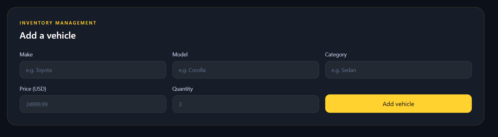
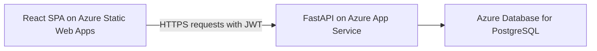

# Motora — Car Dealership Inventory System

Motora is a full-stack inventory application for a car dealership. Visitors can create an account, sign in, browse and filter vehicles, and reserve a vehicle by reducing its stock count. Administrators have a dashboard for managing the inventory.

This project was built as a test-driven development kata. It demonstrates a REST API, persistent data storage, token-based authentication, a responsive single-page interface, automated backend tests, and an Azure deployment.

> **About “purchase”:** A purchase updates the inventory quantity by one. This demo does not collect payment, place an order, or process a real financial transaction.

## Try the live application

- **Frontend:** https://kind-bush-0cefb9800.6.azurestaticapps.net
- **Interactive API documentation:** https://motora-demo-api-1-e4gcb9hefcgdd5fm.westindia-01.azurewebsites.net/docs
- **Source code:** https://github.com/This-AnneGeorge/AnneGeorge_Incubyte

Register an account on the frontend to try browsing, searching, and purchasing. New accounts have the `user` role. Administrator access must be granted separately; the public registration form cannot create an admin account.

The API is hosted on a paid Azure App Service plan. Availability depends on that plan and the PostgreSQL server remaining active.

## Screenshots

### Sign in


### Inventory


### Admin controls


### Add a vehicle



## What the application does

| Feature | Behavior |
| --- | --- |
| Registration and login | Creates a user account, verifies a password, and issues a JWT access token. |
| Inventory | Lists vehicles with their make, model, category, price, and stock quantity. Sold-out vehicles remain visible. |
| Search | Combines optional make, model, category, minimum price, and maximum price filters. Text matching is case-insensitive and supports partial matches. |
| Purchase | Decreases stock by one when stock is available. A sold-out vehicle cannot be purchased. |
| Inventory management | Admins see forms and controls to add, edit, delete, and restock vehicles. |
| Responsive interface | The React dashboard adapts to smaller and larger screens and shows loading, success, and error states. |

The **API authorization rules** are slightly broader than the admin-only controls shown in the frontend: adding and updating vehicles require a signed-in user, while deleting and restocking require an admin. This follows the endpoint permissions implemented for the kata. Frontend visibility is for usability; the backend checks permissions independently.

## Technology and why it was chosen

| Area | Technology | Reason |
| --- | --- | --- |
| Backend | Python and FastAPI | FastAPI provides clear REST routes, request validation, generated API documentation, and a straightforward testing interface. |
| Data models and persistence | SQLModel and SQLAlchemy | Vehicle and user records are represented as Python models and stored in a relational database. |
| Local database | SQLite file | A persistent database with minimal setup makes local development and automated tests easy to run. |
| Hosted database | Azure Database for PostgreSQL | Keeps production data outside the web app container, where it survives app restarts and deployments. |
| Authentication | Argon2 password hashing and JWT bearer tokens | Passwords are stored as hashes; the API uses short-lived tokens to identify signed-in users. |
| Frontend | React, HTML5, CSS3, Tailwind CSS, and Vite | React manages the single-page interface, Tailwind handles responsive styling, and Vite provides a fast development server and production build. |
| Backend testing | pytest, FastAPI TestClient, pytest-cov | Tests exercise API behavior with temporary databases and report backend code coverage. |
| Hosting | Azure Static Web Apps and Azure App Service | The static React build and Python API are deployed as separate services. |

### Architecture



The browser loads the React application. After login, the frontend sends the JWT in an `Authorization: Bearer <token>` header when calling protected endpoints. FastAPI validates the token, checks the current user's role when required, and reads or updates the database.

For local development, the same backend uses a SQLite database file instead of PostgreSQL. The database connection is selected using `DATABASE_URL`; no separate API implementation is needed.

### Data model

A **user** has a unique email address, a password hash, and a role (`user` or `admin`). A **vehicle** has a database-generated unique ID, make, model, category, price, and nonnegative quantity.

Prices use a decimal value in the backend to represent money to two decimal places. The interface displays prices in US dollars. This is a demonstration currency choice, not a payment integration.

### Stock safety

The purchase endpoint performs a conditional database update: it decreases quantity only when the current quantity is greater than zero. If the vehicle does not exist, the API responds with `404`. If it exists but is sold out, the API responds with `409`. This prevents a successful purchase from taking inventory below zero, including when requests arrive close together.

## Run the project locally

The commands below are for **Windows PowerShell in the VS Code terminal**.

### Prerequisites

- Python 3.10 or newer; the recorded tests ran on Python 3.13.4.
- Node.js compatible with the version of Vite in `frontend/package.json` and npm.
- Git.

### 1. Clone the repository

Run in the **VS Code PowerShell terminal** from the folder where you want to keep the project:

```powershell
git clone https://github.com/This-AnneGeorge/AnneGeorge_Incubyte.git
cd AnneGeorge_Incubyte
```

### 2. Install and start the backend

Run in the **VS Code PowerShell terminal**, inside the `backend` folder:

```powershell
cd backend
python -m venv .venv
.\.venv\Scripts\python.exe -m pip install -r requirements.txt
```

Set a JWT signing secret for this terminal session:

```powershell
$env:JWT_SECRET_KEY = (& .\.venv\Scripts\python.exe -c "import secrets; print(secrets.token_urlsafe(32))")
```

Start the API:

```powershell
.\.venv\Scripts\python.exe -m uvicorn app.main:app --reload
```

The backend is available at http://127.0.0.1:8000, and its interactive documentation is at http://127.0.0.1:8000/docs.

Without a `DATABASE_URL`, the backend creates a persistent SQLite file named `backend/dealership.db`. That file is excluded from Git. Keep this terminal running while using the frontend.

The generated JWT secret lasts only for the current terminal session. If you restart the backend with a new secret, sign in again because existing tokens will no longer verify.

### 3. Install and start the frontend

Open a **second VS Code PowerShell terminal** at the repository root and run:

```powershell
cd frontend
npm ci
npm run dev
```

Open http://localhost:5173 in a browser.

During local development, the Vite configuration forwards requests beginning with `/api` to the backend at `http://127.0.0.1:8000`. This is why both servers must be running.

### 4. Create an admin account for local testing

First, register an account through the frontend. Registration deliberately creates a regular user.

Then run this command in a **VS Code PowerShell terminal inside `backend`**, replacing the example email with the registered email:

```powershell
.\.venv\Scripts\python.exe promote_admin.py "your-email@example.com"
```

Sign out and sign back in to display the admin controls. The promotion script requires access to the same database as the API. There is no public endpoint that grants admin rights.

## Configuration

| Setting | Where it is used | Purpose |
| --- | --- | --- |
| `DATABASE_URL` | Backend | Optional locally; defaults to `sqlite:///./dealership.db`. In Azure, points to PostgreSQL. |
| `JWT_SECRET_KEY` | Backend | Signs and verifies access tokens. Required when `APP_ENV=production`. Keep it private. |
| `APP_ENV` | Backend | Set to `production` in Azure to require an explicit JWT secret. |
| `CORS_ORIGINS` | Backend | Comma-separated browser origins allowed to call the API; defaults to `http://localhost:5173`. The deployed value is the exact Azure frontend origin. |
| `VITE_API_BASE_URL` | Frontend build | API origin embedded in a production frontend build. Local development uses Vite's `/api` proxy when this is unset. |

Do not commit database passwords or JWT secrets. A Vite variable beginning with `VITE_` is included in browser-delivered code, so it must contain only public configuration such as the API URL.

## API reference

All vehicle routes require a bearer token. `/api/auth/me` also requires a token.

| Method | Route | Action | Permission |
| --- | --- | --- | --- |
| `POST` | `/api/auth/register` | Create a regular user account | Public |
| `POST` | `/api/auth/login` | Return a JWT access token | Public |
| `GET` | `/api/auth/me` | Return the current user's email and role | Signed-in user |
| `POST` | `/api/vehicles` | Add a vehicle | Signed-in user |
| `GET` | `/api/vehicles` | List vehicles, including sold-out vehicles | Signed-in user |
| `GET` | `/api/vehicles/search` | Filter vehicles | Signed-in user |
| `PUT` | `/api/vehicles/{id}` | Replace vehicle details | Signed-in user |
| `DELETE` | `/api/vehicles/{id}` | Delete a vehicle | Admin |
| `POST` | `/api/vehicles/{id}/purchase` | Decrease quantity by one | Signed-in user |
| `POST` | `/api/vehicles/{id}/restock` | Increase quantity | Admin |

Search accepts optional `make`, `model`, `category`, `min_price`, and `max_price` query parameters. You can combine them. Restocking accepts a JSON body such as `{"amount": 3}`; purchasing takes no request body.

Vehicle creation and updates require make, model, category, price greater than zero, and quantity of zero or more. Blank or whitespace-only text fields are rejected.

Common responses include `401` for missing or invalid authentication, `403` for insufficient permission, `404` for a missing vehicle, `409` for a duplicate account or sold-out purchase, and `422` for invalid input.

See the interactive API documentation for request and response schemas.

## Tests and test-driven development

Backend features were developed through Red–Green–Refactor cycles: write a test for the desired behavior, observe the failure, implement the behavior, and improve the code while keeping the tests green. The tests cover authentication, vehicle operations, searching, purchasing, restocking, role restrictions, and input validation.

Run the tests from the **VS Code PowerShell terminal inside `backend`**:

```powershell
.\.venv\Scripts\python.exe -m pytest tests -q --cov=app --cov-report=term-missing
```

The recorded backend run reported **15 passed, 0 failed, and 93% line coverage**. The tests use temporary SQLite databases, so running them does not change `backend/dealership.db`. The run also reported three non-failing dependency/resource warnings; the exact output is preserved in [TEST_REPORT.md](TEST_REPORT.md).

To check the frontend production build, run in the **VS Code PowerShell terminal inside `frontend`**:

```powershell
npm run build
```

The deployed frontend and API were also checked manually for registration, login, inventory management, and purchasing. Automated frontend tests and a dedicated PostgreSQL integration test suite are not currently included.

## Azure deployment

The deployed system has three separate parts:

1. **Azure Static Web Apps** builds and serves the React frontend from `frontend/`. The GitHub workflow deploys changes from `main` and publishes Vite's `dist` output.
2. **Azure App Service** runs the FastAPI backend using `python -m uvicorn app.main:app --host 0.0.0.0 --port 8000`.
3. **Azure Database for PostgreSQL** stores production users and vehicles. The backend reaches it through the configured `DATABASE_URL`.

This separation matters because the frontend is static, while the API needs a running Python process and the database needs persistent storage. The API permits the deployed frontend origin through `CORS_ORIGINS`. Azure holds the production database URL and JWT secret as app settings rather than frontend variables.

The App Service plan is currently **Basic B1**, which can incur ongoing charges; the PostgreSQL resource may also incur charges. Moving the API to a Free tier can make the public demo unavailable when its usage quota is reached.

Database tables are created from the SQLModel models when the API starts. This is suitable for the kata's initial schema; a larger evolving application would need managed database migrations.

## Project layout

```text
AnneGeorge_Incubyte/
├── backend/
│   ├── app/
│   │   ├── database.py          # SQLite/PostgreSQL engine selection
│   │   └── main.py              # Models, validation, auth, and API routes
│   ├── tests/                   # Backend API tests
│   ├── promote_admin.py         # Promote an existing account locally
│   ├── requirements.txt         # Local development and test dependencies
│   └── requirements-prod.txt    # Runtime dependencies for deployment
├── frontend/
│   ├── src/
│   │   ├── App.jsx              # React interface and API calls
│   │   └── index.css            # Tailwind import and application styles
│   ├── vite.config.js           # React, Tailwind, and local API proxy
│   └── package.json
├── screenshots/                 # Application screenshots
├── PROMPTS.md                   # Available AI conversation transcript
├── TEST_REPORT.md               # Recorded test output
└── README.md
```

## My AI Usage

I used **ChatGPT** as a step-by-step coding assistant. It helped draft API and frontend code, suggest tests, explain failures, prepare setup commands, and improve documentation. I executed the commands, ran the tests, checked the application in the browser, and corrected problems found during development and deployment.

For example, the workflow exposed failures before implementing update and delete routes, caught invalid vehicle input, and revealed deployment issues involving an Azure quota, database connectivity, and an incorrectly saved CORS origin. AI suggestions accelerated iteration, but the passing test report and live browser checks were necessary to establish what actually worked.

The available conversation transcript is in [PROMPTS.md](PROMPTS.md). Commit history and [TEST_REPORT.md](TEST_REPORT.md) provide additional context on development and verification.